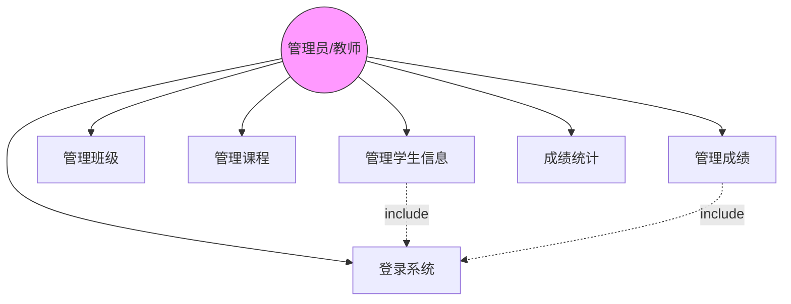
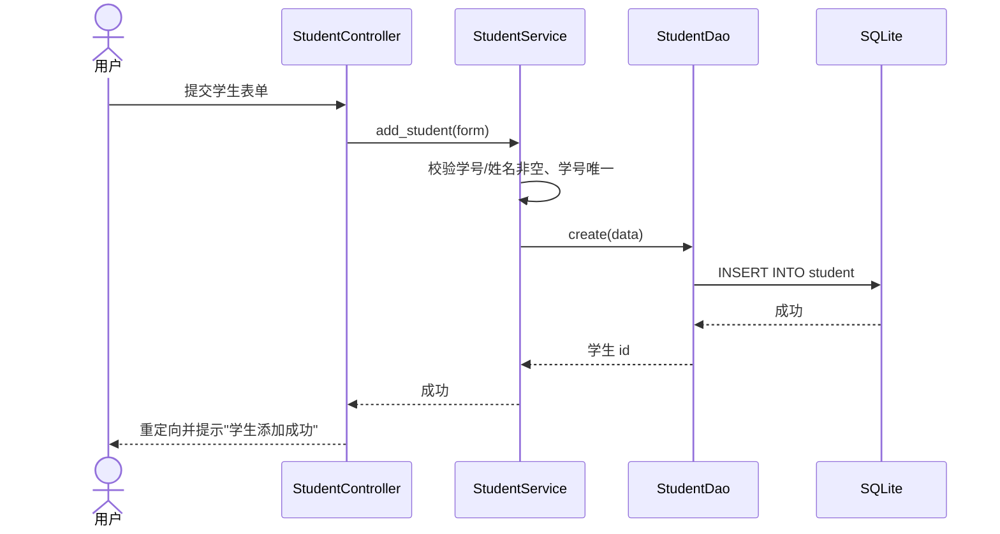
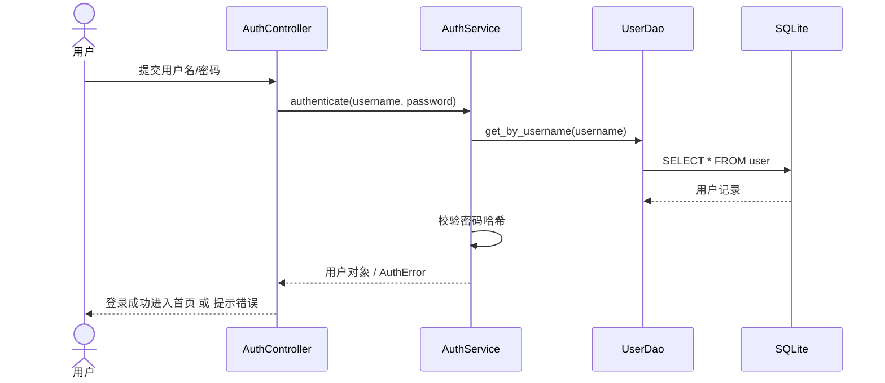
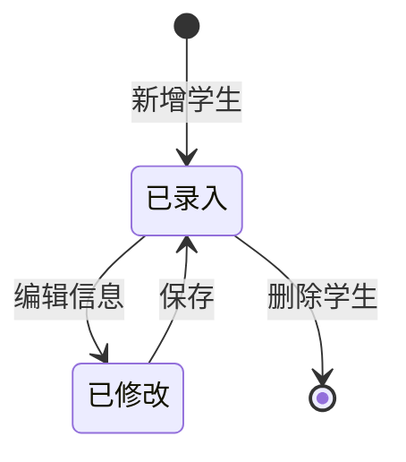

# 学生信息管理系统 软件需求规格说明书

| 文档编号 | SMS – SRS – 1.0 |
| --- | --- |
| 文档名称 | 学生信息管理系统 软件需求规格说明书 |
| 日期 | 2026-11-12 |

### 文档变更历史记录

| 序号 | 变更日期 | 变更人员 | 变更内容详情描述 | 变更后的版本号 |
| --- | --- | --- | --- | --- |
| 1 | 2026-11-12 | 开发团队 | 初稿 | 1.0 |

---

## 1. 引言

### 1.1 编写目的

本文档描述「学生信息管理系统（Student Information Management System）」的功能需求与非功能需求，作为后续总体设计、详细设计、编码、测试与验收的依据。

### 1.2 读者对象

软件需求分析人员、开发人员、测试人员、项目管理人员、学校教务管理人员及评审相关方。

### 1.3 软件项目概述

- **项目名称**：学生信息管理系统；
- **用户单位**：学校教务部门、教师、学生；
- **开发单位**：本课程实践开发团队；
- **大致功能**：对学生、班级、课程、成绩等信息进行统一管理，提供增删改查、搜索、成绩统计、用户登录等功能。

### 1.4 文档概述

本文档给出软件的一般性描述、功能需求（用例模型、分析模型），以及性能、界面、交付与验收等其它需求，并附软件原型说明。

### 1.5 定义

| 术语 | 说明 |
| --- | --- |
| 学生（Student） | 学校注册的在校学生，具有学号、姓名、班级等属性 |
| 班级（Class） | 由若干学生组成的管理单元 |
| 课程（Course） | 教学计划中的一门课程 |
| 成绩（Grade） | 某学生在某课程某学期的得分（0~100） |
| 三层架构 | 表示层 / 业务逻辑层 / 数据访问层 的分层结构 |

### 1.6 参考资料

- 《软件工程》课程实践作业要求；
- 《软件需求规格说明书》模板；
- Python Flask 官方文档、SQLite 文档。

---

## 2. 软件的一般性描述

### 2.1 软件产品与其环境之间的关系

本系统为 B/S（浏览器/服务器）架构的 Web 应用，运行关系如下：

- **浏览器（用户）**：通过 HTTP 与 Web 服务器交互，提交表单、查看数据；
- **Web 服务器（Flask）**：接收请求、执行业务逻辑、渲染页面；
- **SQLite 数据库**：持久化存储学生、班级、课程、成绩、用户数据。

### 2.2 限制与约束

- 系统为单机部署的 Web 应用，数据库使用 SQLite；
- 需通过用户名/密码登录后方可访问各功能模块。

### 2.3 假设与前提条件

- 用户使用现代浏览器访问；
- 系统运行环境已安装 Python 3.8+ 及 Flask。

---

## 3. 软件功能需求描述

### 3.1 软件功能概述

| 功能标识 | 功能名称 | 优先级 | 使用场景 |
| --- | --- | --- | --- |
| F1 | 用户登录/登出 | 高 | 用户输入账号密码进入系统 |
| F2 | 学生信息管理 | 高 | 对学生信息的增删改查与搜索 |
| F3 | 班级管理 | 中 | 对班级信息的增删改查 |
| F4 | 课程管理 | 中 | 对课程信息的增删改查 |
| F5 | 成绩管理 | 高 | 录入、修改、删除、筛选成绩 |
| F6 | 成绩统计 | 中 | 统计平均分、最高分、最低分、及格率 |

### 3.2 软件需求的用例模型

#### 用例图

> 完整 PlantUML 用例图见 `docs/diagrams/usecase.puml`。

#### 用例描述

**UC2 管理学生信息**

- **参与者**：管理员/教师
- **基本流程**：
  1. 用户进入学生管理页；
  2. 系统列表展示全部学生；
  3. 用户可新增、编辑、删除、按学号/姓名搜索学生；
  4. 系统校验数据（学号、姓名非空，学号唯一）并写入数据库。
- **后置条件**：学生数据被更新，列表刷新。

**UC5 管理成绩**

- **参与者**：管理员/教师
- **基本流程**：用户选择学生与课程，录入成绩（0~100），系统校验后保存；可编辑、删除、按学生/课程筛选。

### 3.3 软件需求的分析模型

#### 顺序图（新增学生）

#### 顺序图（登录）

#### 状态图（学生对象）

---

## 4. 其它软件需求描述

### 4.1 性能要求

- 页面响应时间应小于 1 秒（数据量 ≤ 1 万条）；
- 列表查询与搜索应在毫秒级完成（数据库索引支撑）。

### 4.2 设计约束

- 开发语言：Python 3.8+；
- Web 框架：Flask；
- 数据库：SQLite（可平滑替换为 MySQL）；
- 架构：三层架构（表示层 / 业务逻辑层 / 数据访问层）。

### 4.3 界面要求

- 界面简洁、统一，顶部导航栏直达各功能模块；
- 表单提供必填校验与友好错误提示；
- 列表支持搜索/筛选，删除操作二次确认。

### 4.4 进度要求

按软件工程生命周期分阶段推进：需求分析 → 总体设计 → 详细设计 → 编码 → 测试 → 部署，全程 Git 版本控制。

### 4.5 交付要求

交付需求规格说明书、总体设计方案、设计规格说明书、测试报告、UML 模型图、源码仓库。

### 4.6 验收要求

- 功能验收：各用例可正常执行，数据增删改查正确；
- 文档验收：SRS、设计文档、测试报告齐备；
- 版本验收：源码纳入 Git 并实施版本控制。

---

## 5. 软件原型

系统采用 Web 界面原型，主要页面：

- **登录页**：用户名/密码表单；
- **首页（仪表盘）**：展示学生、班级、课程、成绩数量统计卡片；
- **学生管理页**：学生表格 + 搜索框 + 新增/编辑/删除；
- **班级/课程管理页**：对应信息表格 + 增删改查；
- **成绩管理页**：成绩表格 + 学生/课程筛选 + 录入/编辑/删除；
- **成绩统计页**：平均分、最高分、最低分、及格率统计卡片。

> 界面原型实现见 `src/templates/`（HTML 模板）与 `src/static/style.css`。
