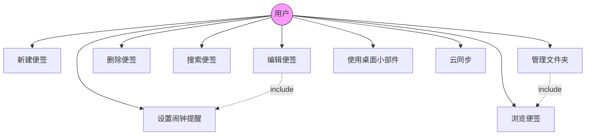
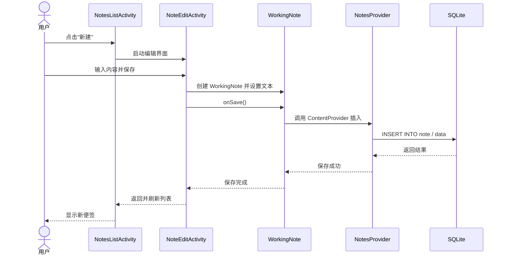
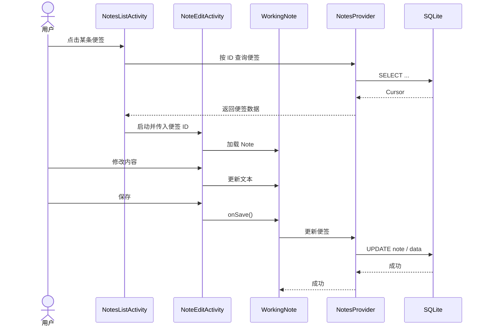
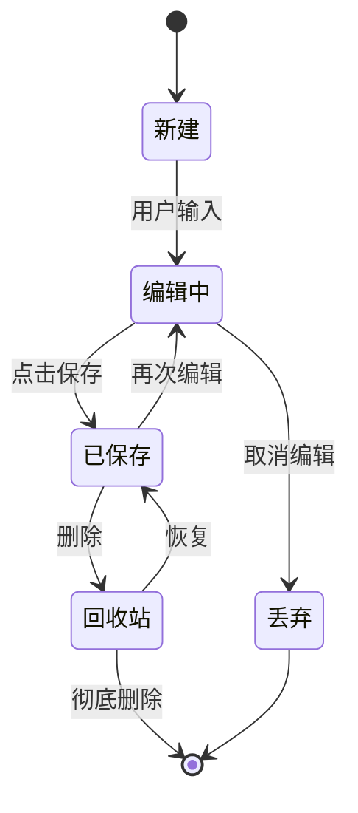

# 小米便签（MiCode Notes）软件需求规格说明书

| 文档编号 | MiNotes – SRS – 1.0 |
| --- | --- |
| 文档名称 | 小米便签（MiCode Notes）软件需求规格说明书 |
| 日期 | 2026-11-12 |

### 文档变更历史记录

| 序号 | 变更日期 | 变更人员 | 变更内容详情描述 | 变更后的版本号 |
| --- | --- | --- | --- | --- |
| 1 | 2026-11-12 | 开发团队 | 初稿 | 1.0 |

---

## 1. 引言

### 1.1 编写目的

本文档描述「小米便签（MiCode Notes）便签信息管理系统」的功能需求与非功能需求，作为后续总体设计、详细设计、编码、测试与验收的依据，供开发人员、测试人员、项目管理与用户共同使用。

### 1.2 读者对象

- 软件需求分析人员与开发人员；
- 软件测试人员；
- 项目管理人员；
- 用户及评审相关方（stakeholders）。

### 1.3 软件项目概述

- **项目名称**：小米便签（MiCode Notes）便签信息管理系统；
- **用户单位**：广大 Android 手机用户；
- **开发单位**：MiCode 开源社区（本实践对其进行分析与文档化）；
- **大致功能**：提供便签的新建、编辑、删除、搜索、文件夹分类、闹钟提醒、桌面小组件、通话记录、Google 任务同步等功能，帮助用户高效管理文字信息。

### 1.4 文档概述

本文档首先给出软件的一般性描述，然后详细描述功能需求（用例模型、分析模型），最后给出性能、界面、交付与验收等其它需求，并附软件原型说明。

### 1.5 定义

| 术语 | 说明 |
| --- | --- |
| 便签（Note） | 一条文字记录，可设置背景色、提醒时间、所属文件夹 |
| 文件夹（Folder） | 用于归类便签的容器，包括系统文件夹与用户文件夹 |
| ContentProvider | Android 平台进程间数据访问的统一接口 |
| Google 任务（gtask） | 与 Google Tasks 进行云端同步的功能 |
| 桌面小部件（Widget） | 在桌面直接展示/创建便签的组件 |

### 1.6 参考资料

- MiCode Notes 源码与 README：https://github.com/MiCode/Notes
- 《软件工程》课程实践作业要求
- 《软件需求规格说明书》模板

---

## 2. 软件的一般性描述

### 2.1 软件产品与其环境之间的关系

小米便签运行于 Android 操作系统之上，与以下外部环境交互：

- **Android 系统服务**：闹钟服务（AlarmManager）、联系人（ContactsProvider）、通知；
- **桌面 Launcher**：通过 AppWidget 展示便签小组件；
- **SQLite 数据库**：本地持久化存储便签与文件夹数据；
- **Google Tasks 云端**：通过 gtask 模块进行网络同步；
- **外部用户**：通过触摸屏交互完成便签的查看与编辑。

### 2.2 限制与约束

- 运行平台限制为 Android 4.0（API 14）及以上；
- 需要申请网络、联系人、外部存储等系统权限；
- 云同步依赖 Google 账户与网络环境。

### 2.3 假设与前提条件

- 用户已有一台 Android 设备，并能熟练进行触屏操作；
- 便签数据以本地 SQLite 存储为主，网络同步为可选功能。

---

## 3. 软件功能需求描述

### 3.1 软件功能概述

| 功能标识 | 功能名称 | 优先级 | 使用场景 |
| --- | --- | --- | --- |
| F1 | 新建便签 | 高 | 用户点击新建按钮，录入文字内容 |
| F2 | 编辑便签 | 高 | 用户修改便签文字、背景色、提醒 |
| F3 | 删除便签 | 高 | 用户删除不再需要的便签（移入回收站） |
| F4 | 查看/浏览便签 | 高 | 用户在列表中查看便签摘要 |
| F5 | 搜索便签 | 中 | 用户按关键字搜索便签 |
| F6 | 文件夹管理 | 中 | 用户新建、重命名、删除文件夹并归类便签 |
| F7 | 闹钟提醒 | 中 | 用户为便签设置提醒时间，到期弹出提醒 |
| F8 | 桌面小部件 | 中 | 用户在桌面直接查看/新建便签 |
| F9 | 通话记录 | 低 | 系统记录通话并生成通话便签 |
| F10 | 云同步 | 低 | 与 Google Tasks 双向同步 |

### 3.2 软件需求的用例模型

#### 用例图

> 完整的 PlantUML 用例图源文件见 `docs/diagrams/usecase.puml`。

#### 用例描述

**UC1 新建便签**

- **参与者**：用户
- **前置条件**：应用已启动
- **基本流程**：
  1. 用户点击「新建便签」；
  2. 系统进入编辑界面；
  3. 用户输入文字内容，可设置背景色、提醒时间、所属文件夹；
  4. 用户保存，系统将便签写入数据库并刷新列表。
- **后置条件**：新便签出现在列表中。

**UC2 编辑便签**

- **参与者**：用户
- **基本流程**：用户在列表点击某条便签 → 系统加载便签内容 → 用户修改 → 保存，系统更新数据库。

**UC3 删除便签**

- **参与者**：用户
- **基本流程**：用户长按/选择便签 → 点击删除 → 便签移入回收站文件夹，可恢复或彻底删除。

**UC6 管理文件夹**

- **参与者**：用户
- **基本流程**：用户在文件夹列表中新建/重命名/删除文件夹，并将便签移动到目标文件夹。

### 3.3 软件需求的分析模型

#### 顺序图（新建便签）

#### 顺序图（编辑便签）

#### 状态图（便签对象）

---

## 4. 其它软件需求描述

### 4.1 性能要求

- 便签列表加载应在 1 秒内完成；
- 单条便签的保存操作应在 500ms 内完成；
- 支持上千条便签的流畅滚动浏览。

### 4.2 设计约束

- 开发工具：Android SDK、Java；
- 运行环境：Android 4.0（API 14）及以上；
- 数据存储：SQLite 数据库（note.db），通过 ContentProvider 访问；
- 开源许可：Apache License 2.0。

### 4.3 界面要求

- 界面简洁直观，符合 Android 设计规范；
- 支持多种背景色（蓝、绿、红、白、黄）；
- 支持字号调整与列表/网格视图切换；
- 主要界面包括：便签列表页、编辑页、文件夹列表页、设置页。

### 4.4 进度要求

按软件工程生命周期分阶段推进：需求分析 → 总体设计 → 详细设计 → 编码 → 测试 → 部署，全程进行版本控制。

### 4.5 交付要求

- 交付内容：需求规格说明书、总体设计方案、设计规格说明书、测试文档、UML 模型图、源码；
- 交付形式：电子文档（Markdown / Word）+ 源码仓库（Git）。

### 4.6 验收要求

- 功能验收：所有用例可正常执行；
- 文档验收：SRS、设计文档、测试报告齐备；
- 版本验收：源码已纳入 Git 仓库并实施版本控制。

---

## 5. 软件原型

小米便签采用**原型模型法**澄清需求，主要交互原型如下：

- **便签列表页**：展示便签摘要（snippet）列表，底部提供「新建」按钮与搜索入口；
- **编辑页**：提供文字输入区，顶部工具条可设置背景色、提醒时间、附件；
- **文件夹页**：以树形/列表展示系统文件夹（全部、通话记录、回收站）与用户文件夹；
- **桌面小部件**：2x、4x 两种规格，可固定在桌面快捷查看与新建便签。

> 界面对应的 Android 布局文件见 `notes/res/layout/`（note_list.xml、note_edit.xml、folder_list_item.xml 等）。
