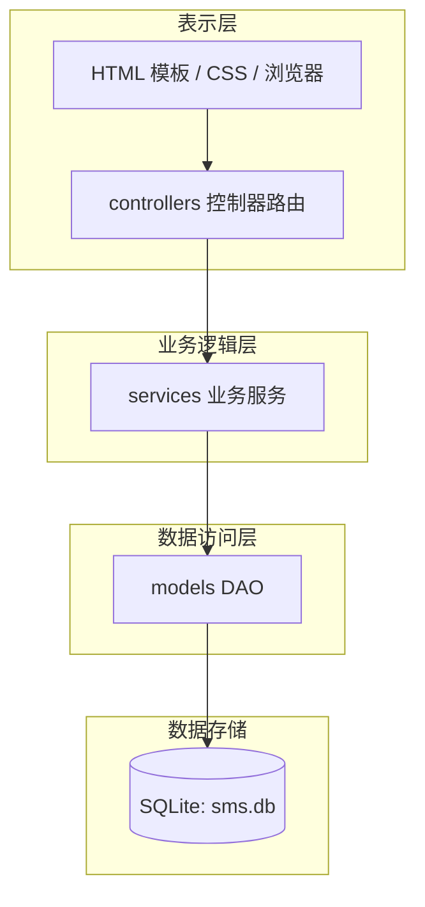
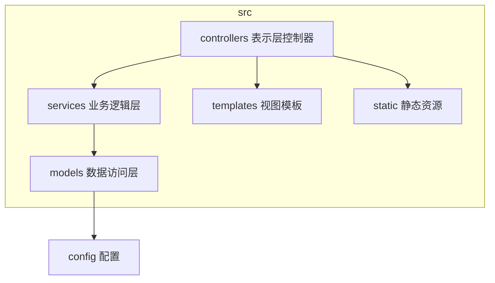
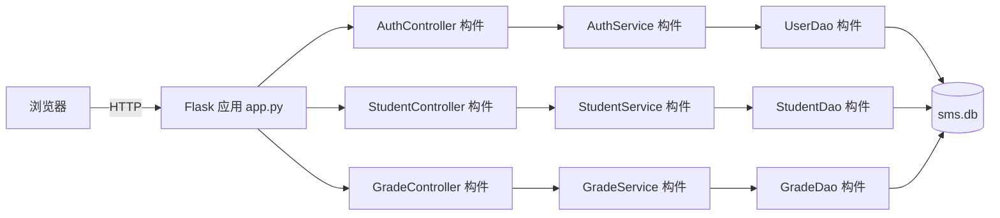
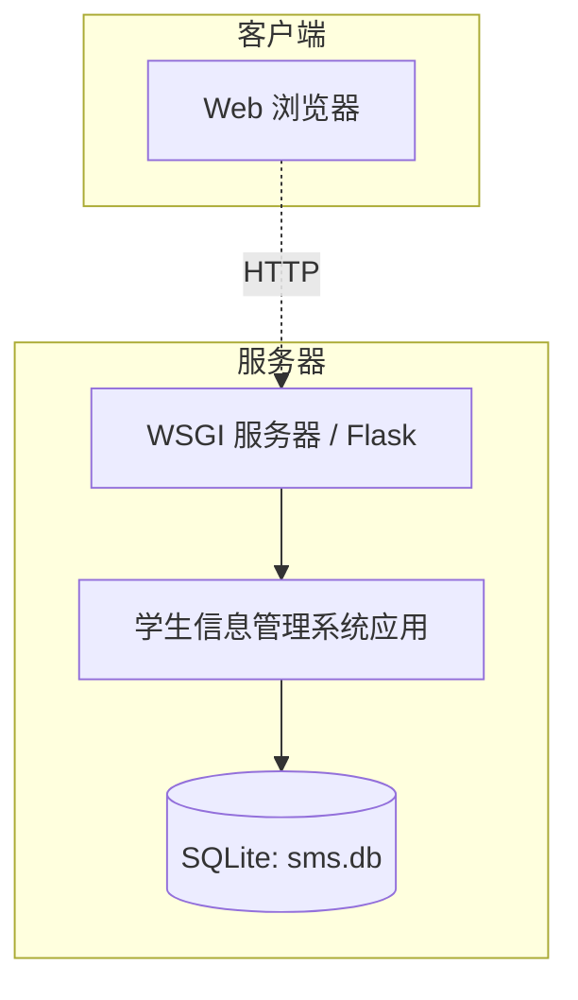

# 学生信息管理系统 软件总体设计方案

| 文档名称 | 软件总体设计方案 |
| --- | --- |
| 版本 | 1.0 |
| 日期 | 2026-11-12 |

---

## 1. 概述

针对需求分析结果，对学生信息管理系统进行整体架构与全局性设计。系统采用**分层架构**，将系统划分为**表示层（Web 前端 + 控制器）、业务逻辑层、数据访问层**，各层职责单一、边界清晰，符合高内聚低耦合原则。

## 2. 分层架构设计

- **表示层**：`templates/`（HTML 模板）、`static/`（CSS/JS）与 `controllers/`（路由控制器），负责界面展示与接收用户请求；
- **业务逻辑层**：`services/`，实现数据校验与业务规则（如学号唯一、成绩 0~100、登录认证）；
- **数据访问层**：`models/`（DAO），封装对 SQLite 的增删改查，屏蔽数据库细节。

## 3. 体系结构设计模型

### 3.1 包图

各包职责与依赖：

| 包 | 职责 | 依赖 |
| --- | --- | --- |
| `controllers` | 接收 HTTP 请求、调用业务层、返回视图 | `services`、`templates` |
| `services` | 业务规则与数据校验 | `models` |
| `models` | 数据库增删改查（DAO） | `config`（数据库路径） |
| `templates` | HTML 视图模板 | — |
| `static` | CSS/JS 静态资源 | — |

### 3.2 构件图

### 3.3 部署图

## 4. 设计元素

- **子系统**：认证子系统、学生管理子系统、班级管理子系统、课程管理子系统、成绩管理子系统、统计子系统；
- **构件**：`app.py`（应用入口）、各 Controller（路由）、各 Service（业务）、各 DAO（数据访问）；
- **类及其消息接口**：详见《软件设计规格说明书》（docs/04）中的类图。

## 5. 关键组件设计

- **认证组件 `AuthService`**：基于 Werkzeug 密码哈希，实现登录校验与会话管理；
- **业务服务组件（Service 层）**：统一封装数据校验（必填、唯一性、数值范围）与业务规则；
- **数据访问组件（DAO 层）**：每个实体一个 DAO，通过参数化 SQL 完成增删改查，防止 SQL 注入；
- **数据库连接组件 `models/db.py`**：提供请求级连接（Flask `g`）与独立连接两种方式，支持外键约束。

## 6. 开源代码重用

- **框架重用**：Flask（Web 框架）、Jinja2（模板引擎）、Werkzeug（WSGI 与密码哈希）、sqlite3（Python 标准库）；
- 本系统为从零开发，未直接复制第三方业务源码，符合软件重用思想并降低开发成本。

## 7. 技术选型

| 层次 | 技术选型 |
| --- | --- |
| 前端/表示层 | HTML5 + CSS3 + JavaScript + Jinja2 模板 |
| 后端/业务逻辑 | Python 3.8+ / Flask |
| 数据库 | SQLite（可替换为 MySQL） |
| 数据访问 | sqlite3 标准库 + DAO 封装 |
| 会话/安全 | Werkzeug 密码哈希 + Flask session |
| 运行平台 | Windows / Linux + Python 运行时 + 现代浏览器 |
