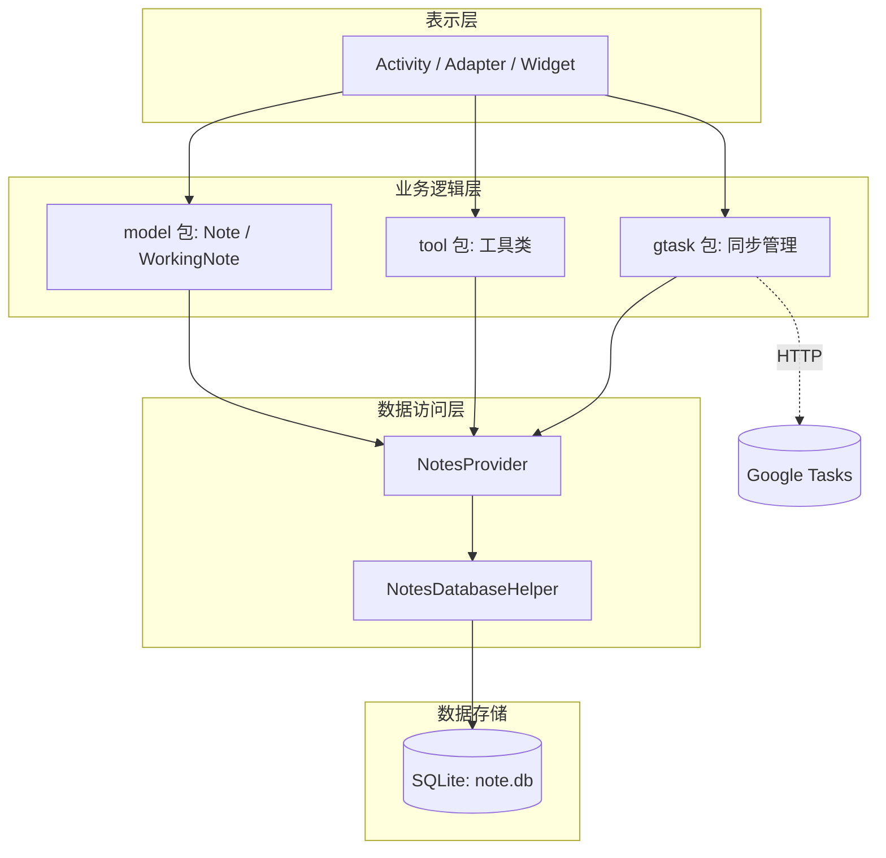
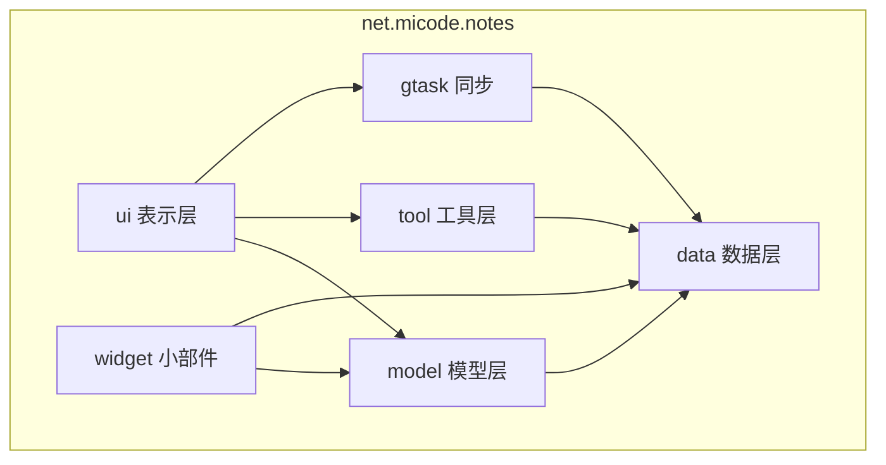
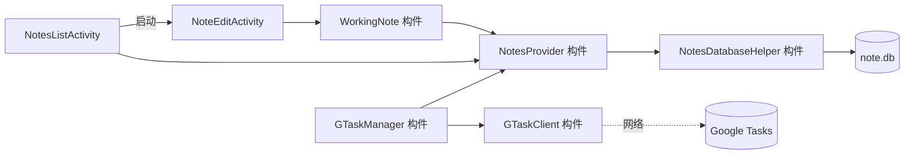
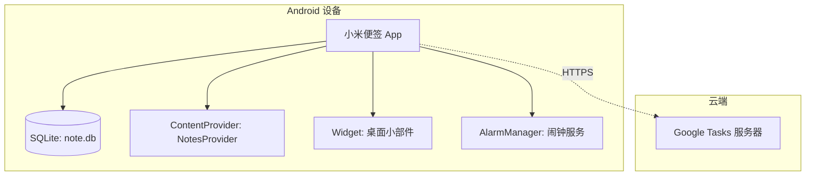

# 小米便签（MiCode Notes）软件总体设计方案

| 文档名称 | 软件总体设计方案 |
| --- | --- |
| 版本 | 1.0 |
| 日期 | 2026-11-12 |

---

## 1. 概述

针对需求分析结果，对小米便签进行整体架构与全局性设计。系统采用经典的**分层架构**，将系统划分为**表示层（UI）、业务逻辑层、数据访问层**，并借助 Android 的 `ContentProvider` 机制实现数据访问与进程间共享。

## 2. 分层架构设计

- **表示层**：`net.micode.notes.ui`、`net.micode.notes.widget`，负责界面展示与用户交互；
- **业务逻辑层**：`net.micode.notes.model`、`net.micode.notes.tool`、`net.micode.notes.gtask`，实现便签编辑、同步等业务逻辑；
- **数据访问层**：`net.micode.notes.data`，通过 `NotesProvider`（ContentProvider）统一封装对 SQLite 的增删改查。

## 3. 体系结构设计模型

### 3.1 包图

各包职责与依赖关系：

| 包 | 职责 | 依赖 |
| --- | --- | --- |
| `data` | 数据模型常量、数据库助手、ContentProvider | — |
| `model` | 业务实体 Note、WorkingNote | `data` |
| `tool` | 通用工具（资源解析、备份、数据工具） | `data` |
| `ui` | 界面 Activity、Adapter、控件 | `model`、`tool`、`gtask` |
| `gtask` | Google 任务同步 | `data`、`tool` |
| `widget` | 桌面小部件 | `model`、`data` |

### 3.2 构件图

### 3.3 部署图

## 4. 设计元素

- **子系统**：便签管理子系统、文件夹管理子系统、提醒子系统、云同步子系统、桌面小部件子系统；
- **构件**：`NotesListActivity`、`NoteEditActivity`、`WorkingNote`、`NotesProvider`、`NotesDatabaseHelper`、`GTaskManager` 等；
- **类及其消息接口**：`Note`（实体类）、`WorkingNote`（编辑工作区）、`Notes`（常量/契约接口）等，详见详细设计。

## 5. 关键组件设计

- **数据访问组件 `NotesProvider`**：继承 `ContentProvider`，对外提供 `content://micode_notes/note` 与 `content://micode_notes/data` 两个 URI，统一封装 `note`、`data` 两张表的增删改查，并负责与 SQLite 交互。
- **编辑工作区组件 `WorkingNote`**：缓存正在编辑的便签内容，仅在保存时批量写回数据库，减少 IO。
- **同步组件 `GTaskManager` / `GTaskClient`**：负责与 Google Tasks 的登录、上传、下载与合并。

## 6. 开源代码重用

本项目直接重用 MiCode 开源社区的 **Notes（小米便签）** 源码（Apache License 2.0），在其基础上进行需求分析、体系结构设计与文档化，体现了软件工程中「软件重用」与「开源协作」的思想。

## 7. 技术选型

| 层次 | 技术选型 |
| --- | --- |
| 前端/表示层 | Android（Java）、自定义 View、AppWidget |
| 后端/业务逻辑 | Java（Android 应用内业务层） |
| 数据库 | SQLite（`note.db`） |
| 数据访问 | ContentProvider（`NotesProvider`） |
| 消息/通知 | Android AlarmManager + Notification |
| 外部接口/同步 | Google Tasks（gtask）REST |
| 运行平台 | Android 4.0（API 14）+ |
