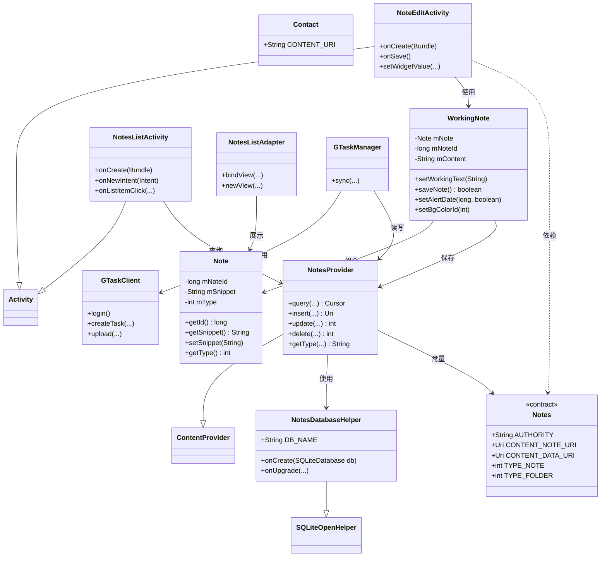
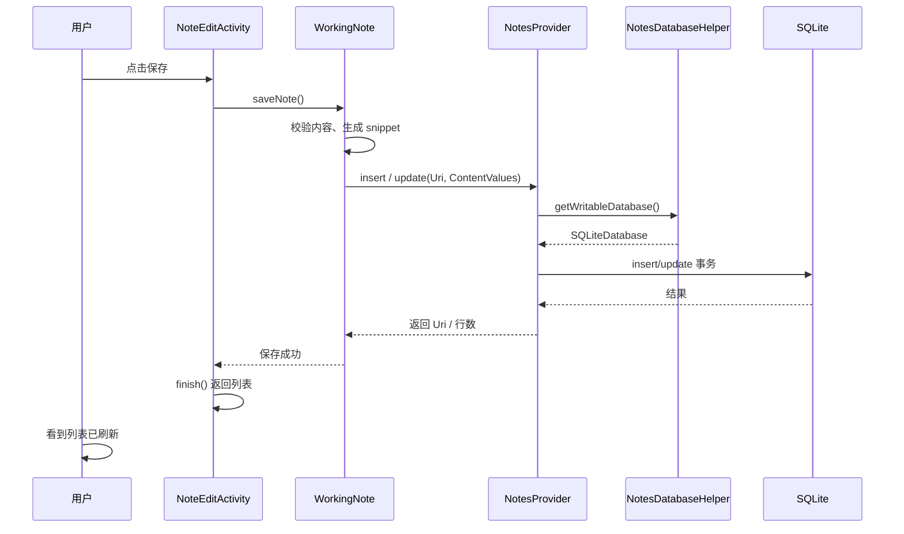
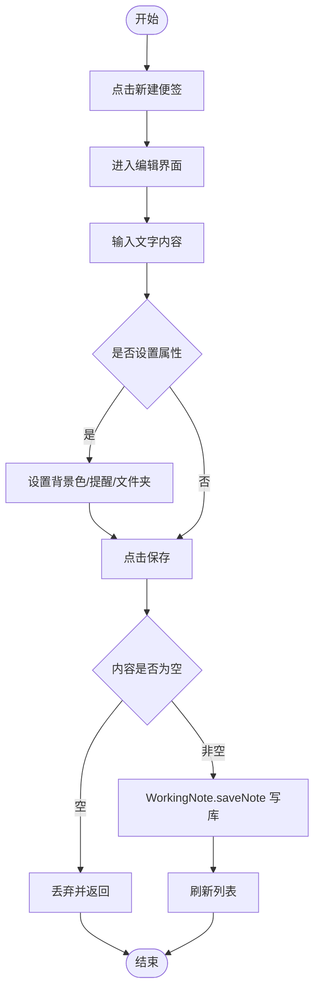

# 小米便签（MiCode Notes）软件设计规格说明书（详细设计）

| 文档名称 | 软件设计规格说明书（SDS） |
| --- | --- |
| 版本 | 1.0 |
| 日期 | 2026-11-12 |

---

## 1. 引言

### 1.1 编写目的

本文档在需求分析（SRS）与总体设计的基础上，对小米便签进行详细设计：将分析类精化、细化为设计类，明确类职责、类间关系、属性与方法，并给出数据设计、子系统/构件设计与详细设计模型。

### 1.2 参考资料

- 《软件需求规格说明书》（docs/02）
- 《软件总体设计方案》（docs/03）
- MiCode Notes 源码（notes/）

## 2. 软件设计约束

### 2.1 软件设计目标和原则

- 遵循**高内聚、低耦合**：按数据、模型、UI、工具分层，层间通过接口（ContentProvider、契约类）交互；
- 遵循**信息隐藏**：数据库细节封装在 `NotesProvider` / `NotesDatabaseHelper` 内，UI 不直接访问 SQLite；
- 遵循**软件重用**：重用开源 Notes 源码及 Android 框架组件。

### 2.2 软件设计的约束和限制

- 语言/框架：Java + Android SDK；
- 数据库：SQLite（`note.db`）；
- 最低 API 14。

## 3. 软件设计

### 3.1 软件体系结构设计

见《软件总体设计方案》（docs/03）：系统采用表示层 / 业务逻辑层 / 数据访问层的三层架构。

### 3.2 用户界面设计

主要界面与对应布局：

| 界面 | Activity | 布局文件 |
| --- | --- | --- |
| 便签列表页 | `NotesListActivity` | `note_list.xml`、`note_item.xml` |
| 便签编辑页 | `NoteEditActivity` | `note_edit.xml` |
| 文件夹列表页 | `FoldersListAdapter` | `folder_list_item.xml` |
| 设置页 | `NotesPreferenceActivity` | `preferences.xml` |
| 桌面小部件 | `NoteWidgetProvider_2x/4x` | `widget_2x.xml`、`widget_4x.xml` |

### 3.3 用例设计

核心用例到设计类/构件的映射：

| 用例 | 主要参与类/构件 |
| --- | --- |
| 新建/编辑便签 | `NoteEditActivity`、`WorkingNote`、`Note`、`NotesProvider` |
| 浏览/删除便签 | `NotesListActivity`、`NotesListAdapter`、`NotesProvider` |
| 管理文件夹 | `FoldersListAdapter`、`NotesProvider` |
| 闹钟提醒 | `AlarmReceiver`、`AlarmAlertActivity` |
| 云同步 | `GTaskManager`、`GTaskClient`、`GTaskASyncTask` |

---

## 4. 类设计（详细设计模型）

### 4.1 类图

**关键设计类职责与关系说明：**

- `Notes`（契约类）：集中定义数据表的列名、URI、类型等常量，供各层引用，实现「信息隐藏」与命名统一；
- `NotesDatabaseHelper`：继承 `SQLiteOpenHelper`，负责建库、建表、建触发器与升级；
- `NotesProvider`：继承 `ContentProvider`，是数据访问的唯一入口，对外屏蔽 SQLite 细节；
- `Note`：便签的领域实体，封装 `note` 表一条记录；
- `WorkingNote`：编辑工作区，组合一个 `Note`，缓存编辑内容并在保存时批量写回；
- `NotesListActivity` / `NoteEditActivity`：表示层控制器，响应用户事件。

### 4.2 顺序图（详细设计：编辑保存流程）

### 4.3 活动图（新建便签）

---

## 5. 数据设计

### 5.1 数据库与存储方式

- 数据库：SQLite，文件名 `note.db`；
- 表：`note`（便签/文件夹）、`data`（便签正文与附件元数据）；
- 通过 `NotesProvider` 完成增删改查。

### 5.2 `note` 表

| 字段 | 类型 | 说明 |
| --- | --- | --- |
| `_id` | INTEGER PK | 主键 |
| `parent_id` | INTEGER | 父文件夹 ID |
| `alert_date` | INTEGER | 提醒时间戳 |
| `bg_color_id` | INTEGER | 背景色 ID |
| `created_date` | INTEGER | 创建时间戳 |
| `has_attachment` | INTEGER | 是否有附件 |
| `modified_date` | INTEGER | 修改时间戳 |
| `notes_count` | INTEGER | 文件夹内便签数 |
| `snippet` | TEXT | 摘要/标题 |
| `type` | INTEGER | 类型（0 便签、1 文件夹、2 系统） |
| `widget_id` | INTEGER | 小部件 ID |
| `widget_type` | INTEGER | 小部件类型 |
| `sync_id` | INTEGER | 同步 ID |
| `local_modified` | INTEGER | 本地是否修改 |
| `origin_parent_id` | INTEGER | 移入回收站前的父 ID |
| `gtask_id` | TEXT | Google 任务 ID |
| `version` | INTEGER | 版本号 |

### 5.3 `data` 表

| 字段 | 类型 | 说明 |
| --- | --- | --- |
| `_id` | INTEGER PK | 主键 |
| `mime_type` | TEXT | MIME 类型 |
| `note_id` | INTEGER | 所属便签 ID |
| `created_date` | INTEGER | 创建时间 |
| `modified_date` | INTEGER | 修改时间 |
| `content` | TEXT | 正文内容 |
| `data1`~`data5` | INTEGER/TEXT | 扩展字段（附件、提醒等） |

### 5.4 数据操作与触发器

- **触发器**：维护文件夹便签计数（`notes_count` 增/减）、便签内容与 `data` 的同步、级联删除（删文件夹删便签、删便签删 data）、移入回收站等；
- **索引**：`data(note_id)` 上建立索引 `note_id_index` 加速按便签查询。

---

## 6. 子系统与构件设计

| 子系统 | 主要构件 | 内聚性/耦合性说明 |
| --- | --- | --- |
| 便签管理 | `NotesListActivity`、`NoteEditActivity`、`WorkingNote` | 功能内聚，通过 `NotesProvider` 与数据层低耦合交互 |
| 文件夹管理 | `FoldersListAdapter`、`NotesProvider` | 复用便签数据模型 |
| 提醒 | `AlarmReceiver`、`AlarmAlertActivity`、`AlarmInitReceiver` | 与便签通过 `alert_date` 字段松耦合 |
| 云同步 | `GTaskManager`、`GTaskClient`、`GTaskASyncTask`、`GTaskSyncService` | 独立成包，通过 `NotesProvider` 读写 |
| 桌面小部件 | `NoteWidgetProvider`、`NoteWidgetProvider_2x/4x` | 依赖便签数据，独立于主界面 |

各子系统职责单一、边界清晰，符合高内聚低耦合原则。
