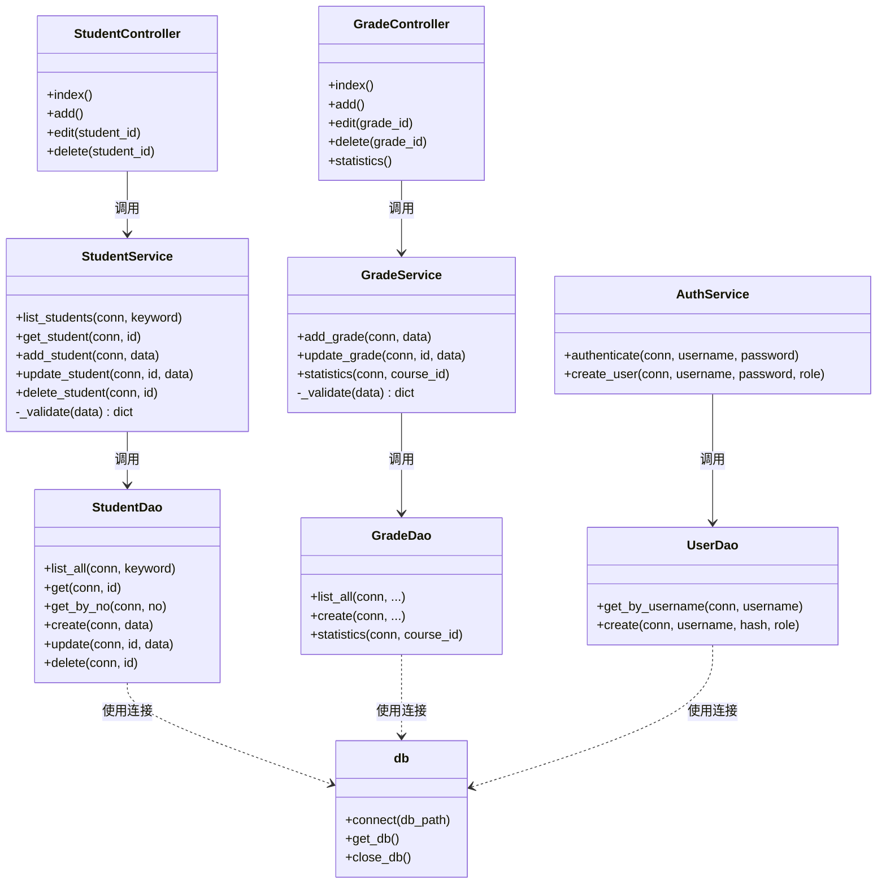
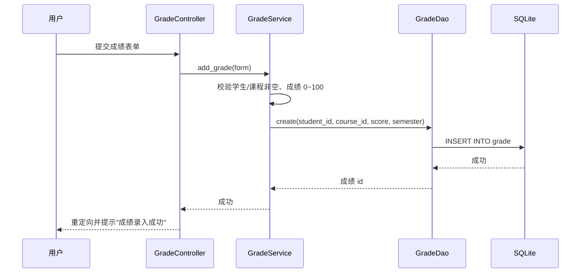

# 学生信息管理系统 软件设计规格说明书（详细设计）

| 文档名称 | 软件设计规格说明书（SDS） |
| --- | --- |
| 版本 | 1.0 |
| 日期 | 2026-11-12 |

---

## 1. 引言

### 1.1 编写目的

本文档在需求分析（SRS）与总体设计的基础上，对学生信息管理系统进行详细设计：明确各类职责、类间关系、属性与方法，并给出数据设计、子系统/构件设计与详细设计模型（类图、顺序图、活动图）。

### 1.2 参考资料

- 《软件需求规格说明书》（docs/02）
- 《软件总体设计方案》（docs/03）
- 源码：`src/`

## 2. 软件设计约束

### 2.1 软件设计目标和原则

- **高内聚、低耦合**：按 表示层（controllers）/ 业务逻辑层（services）/ 数据访问层（models）分层，层间单向依赖；
- **信息隐藏**：数据库细节封装在 DAO 层，上层不直接操作 SQL；
- **单一职责**：每个 DAO/Service 只负责一个实体的操作。

### 2.2 软件设计的约束和限制

- 语言/框架：Python 3.8+ / Flask；
- 数据库：SQLite（`sms.db`），支持外键约束；
- 密码存储必须使用哈希，禁止明文。

## 3. 软件设计

### 3.1 软件体系结构设计

见《软件总体设计方案》（docs/03），三层架构。

### 3.2 用户界面设计

| 界面 | 控制器/模板 | 说明 |
| --- | --- | --- |
| 登录页 | `auth.py` / `login.html` | 用户名密码登录 |
| 首页仪表盘 | `dashboard.py` / `dashboard.html` | 数据统计卡片 |
| 学生管理页 | `student.py` / `students.html`、`student_form.html` | 列表 + 表单 |
| 班级管理页 | `class_ctrl.py` / `classes.html`、`class_form.html` | 列表 + 表单 |
| 课程管理页 | `course.py` / `courses.html`、`course_form.html` | 列表 + 表单 |
| 成绩管理页 | `grade.py` / `grades.html`、`grade_form.html` | 列表 + 筛选 + 表单 |
| 成绩统计页 | `grade.py` / `statistics.html` | 统计卡片 |

### 3.3 用例设计

| 用例 | 主要参与类/构件 |
| --- | --- |
| 登录 | `AuthController`、`AuthService`、`UserDao` |
| 学生增删改查 | `StudentController`、`StudentService`、`StudentDao` |
| 班级增删改查 | `ClassController`、`ClassService`、`ClassDao` |
| 课程增删改查 | `CourseController`、`CourseService`、`CourseDao` |
| 成绩录入/统计 | `GradeController`、`GradeService`、`GradeDao` |

---

## 4. 类设计（详细设计模型）

### 4.1 类图



**类职责与关系说明：**

- **Controller（控制器类）**：属于表示层，接收 HTTP 请求，调用 Service，返回视图/重定向；`StudentController` 依赖 `StudentService`；
- **Service（业务类）**：属于业务逻辑层，实现数据校验与业务规则，依赖对应 DAO；
- **DAO（数据访问类）**：属于数据访问层，封装 SQL 增删改查，使用 `db` 模块提供的数据库连接；
- **`db`（连接管理）**：提供 `connect` / `get_db` / `close_db`，是数据访问层的公共基础设施。

### 4.2 顺序图（录入成绩）



### 4.3 活动图（新增学生）

```mermaid
flowchart TD
    Start([开始]) --> Open[打开新增学生表单]
    Open --> Input[填写学号、姓名等信息]
    Input --> Submit[点击保存]
    Submit --> V1{学号、姓名是否为空}
    V1 -->|为空| Err1[提示"学号/姓名不能为空"]
    Err1 --> Open
    V1 -->|非空| V2{学号是否已存在}
    V2 -->|已存在| Err2[提示"学号已存在"]
    Err2 --> Open
    V2 -->|不存在| Save[StudentDao 写入数据库]
    Save --> Refresh[重定向到列表并提示成功]
    Refresh --> End([结束])
```

---

## 5. 数据设计

### 5.1 数据库与存储方式

- 数据库：SQLite，文件 `sms.db`；
- 表：`user`、`class`、`student`、`course`、`grade`；
- 通过 DAO 层完成增删改查，启用外键约束保证数据一致性。

### 5.2 `student` 表

| 字段 | 类型 | 说明 |
| --- | --- | --- |
| `id` | INTEGER PK | 主键 |
| `student_no` | TEXT UNIQUE | 学号（唯一） |
| `name` | TEXT NOT NULL | 姓名 |
| `gender` | TEXT | 性别 |
| `birth_date` | TEXT | 出生日期 |
| `class_id` | INTEGER FK | 所属班级（外键 → class.id） |
| `phone` | TEXT | 联系电话 |
| `email` | TEXT | 邮箱 |

### 5.3 `class` / `course` / `grade` / `user` 表

**`class`（班级）**：`id`、`name`、`major`、`grade`、`head_teacher`。

**`course`（课程）**：`id`、`course_no`（唯一）、`name`、`credit`、`hours`、`teacher`。

**`grade`（成绩）**：`id`、`student_id`（FK→student）、`course_id`（FK→course）、`score`（0~100）、`semester`，并对 `(student_id, course_id, semester)` 建唯一约束。

**`user`（用户）**：`id`、`username`（唯一）、`password_hash`、`role`、`created_at`。

### 5.4 数据操作与外键策略

- 删除学生 → 级联删除其成绩（`ON DELETE CASCADE`）；
- 删除课程 → 级联删除其成绩；
- 删除班级 → 学生 `class_id` 置空（`ON DELETE SET NULL`）；
- 索引：`student(class_id)`、`grade(student_id)`、`grade(course_id)` 加速查询。

---

## 6. 子系统与构件设计

| 子系统 | 主要构件 | 说明 |
| --- | --- | --- |
| 认证子系统 | `AuthController`、`AuthService`、`UserDao` | 登录校验与用户管理 |
| 学生管理子系统 | `StudentController`、`StudentService`、`StudentDao` | 学生 CRUD 与搜索 |
| 班级管理子系统 | `ClassController`、`ClassService`、`ClassDao` | 班级 CRUD |
| 课程管理子系统 | `CourseController`、`CourseService`、`CourseDao` | 课程 CRUD |
| 成绩管理子系统 | `GradeController`、`GradeService`、`GradeDao` | 成绩 CRUD 与统计 |

各子系统职责单一、通过 Service/DAO 接口松耦合协作。
