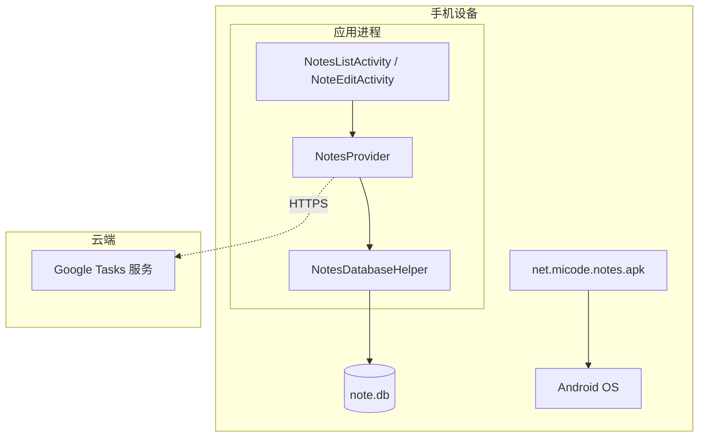

# 小米便签（MiCode Notes）部署与项目管理

| 文档名称 | 部署与项目管理 |
| --- | --- |
| 版本 | 1.0 |
| 日期 | 2026-11-12 |

---

## 1. 部署

### 1.1 基础设施与运行平台

- **运行平台**：Android 4.0（API 14）及以上智能手机/平板；
- **基础设施**：Android 操作系统 + SQLite 数据库 + 本地闹钟/通知服务；
- **外部服务接口**：Google Tasks 云端同步接口（HTTPS）。

### 1.2 构件安装位置

| 构件 | 安装位置 |
| --- | --- |
| 应用 APK | `/data/app/net.micode.notes` |
| 数据库 `note.db` | `/data/data/net.micode.notes/databases/` |
| ContentProvider | 由系统注册于应用进程内 |
| 桌面小部件 | 由 Launcher 通过 AppWidget 机制加载 |

### 1.3 实例部署图

### 1.4 部署步骤

1. 使用 Android SDK 编译生成 APK；
2. `adb install net.micode.notes.apk` 安装到设备；
3. 首次启动自动建库建表（`NotesDatabaseHelper.onCreate`）；
4. 如需云同步，登录 Google 账户并授权。

---

## 2. 项目管理与质量保障

### 2.1 软件仓库与版本控制

本项目使用 **Git** 进行版本控制，托管于 GitHub 仓库 `otreeevol/project`，遵循以下规范：

- 采用 `main` 分支作为主线；
- 每次提交附带清晰的提交说明（commit message）；
- 通过 **ISSUE** 分配任务，将需求拆解为可跟踪的任务项；
- 文档、源码、UML 模型统一纳入仓库，实施配置管理。

### 2.2 团队分工

| 成员 | 角色 | 职责 |
| --- | --- | --- |
| （成员 1） | 项目负责人 / 需求分析 | 需求分析、用例建模、SRS 编写 |
| （成员 2） | 架构设计 | 总体设计、包图/构件图/部署图 |
| （成员 3） | 详细设计 | 类图/顺序图/活动图、数据设计 |
| （成员 4） | 编码 / 测试 | 源码整理、测试计划与用例 |

> 注：团队成员、学号等信息请按实际填写。

### 2.3 质量保障

- **需求评审**：对 SRS 进行评审，确认需求完整、一致；
- **设计评审**：评审总体设计、详细设计是否符合高内聚低耦合原则；
- **代码规范**：遵循 Java 编码规范，注重注释与异常处理；
- **测试保障**：单元、集成、系统、性能测试全覆盖；
- **配置管理**：Git 版本控制 + 变更历史可追溯。

---

## 3. 项目实践任务完成情况

| 任务 | 完成情况 |
| --- | --- |
| 组建团队 | ✅ 已完成（见 2.2） |
| 注册 Git 仓库 | ✅ GitHub `otreeevol/project` |
| 通过 ISSUE 分配任务 | ✅ 已按需求拆解任务 |
| 上传源码 | ✅ `notes/`（MiCode Notes 源码） |
| 提交设计模型与文档 | ✅ `docs/`（SRS、总体设计、SDS、测试、部署） |
| 实施版本控制 | ✅ Git 提交历史与分支管理 |
