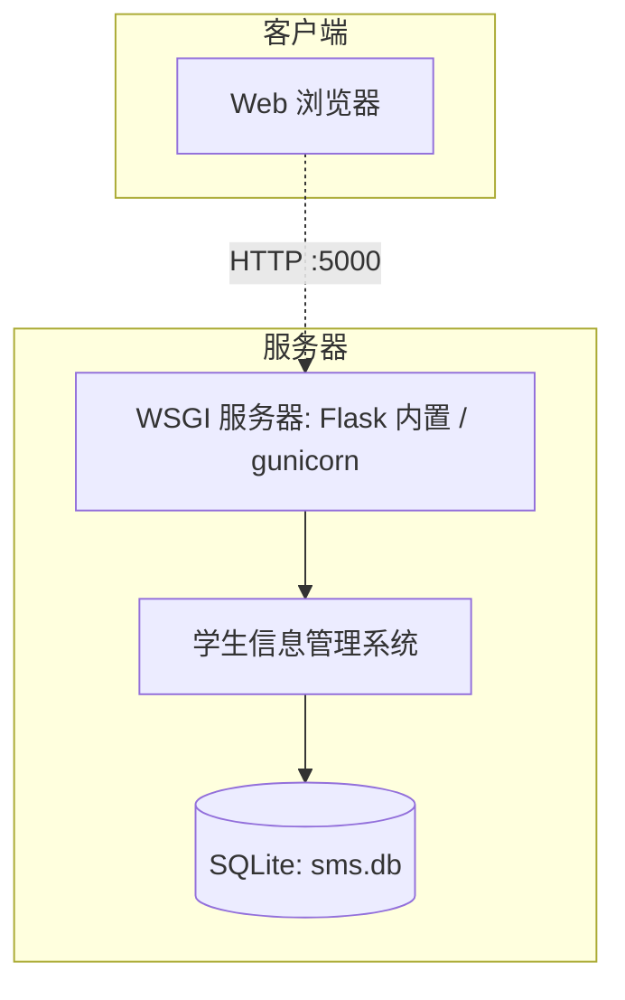

# 学生信息管理系统 部署与项目管理

| 文档名称 | 部署与项目管理 |
| --- | --- |
| 版本 | 1.0 |
| 日期 | 2026-11-12 |

---

## 1. 部署

### 1.1 基础设施与运行平台

- **运行平台**：Windows / Linux，需 Python 3.8+；
- **依赖**：Flask、Werkzeug（见 `src/requirements.txt`）；
- **数据库**：SQLite（`src/sms.db`），随应用部署，无需独立数据库服务。

### 1.2 构件安装位置

| 构件 | 位置 |
| --- | --- |
| 应用源码 | `src/`（app.py、controllers/、services/、models/、templates/、static/） |
| 数据库文件 | `src/sms.db` |
| 依赖清单 | `src/requirements.txt` |
| 建表脚本 | `src/schema.sql`、`src/init_db.py` |

### 1.3 实例部署图



### 1.4 部署步骤

```bash
# 1. 安装依赖
pip install -r requirements.txt

# 2. 初始化数据库（建表 + 默认账号 + 示例数据）
cd src
python init_db.py

# 3. 启动应用
python app.py
# 浏览器访问 http://127.0.0.1:5000
```

默认账号：`admin` / `admin123`。

---

## 2. 项目管理与质量保障

### 2.1 软件仓库与版本控制

本项目使用 **Git** 进行版本控制，托管于 GitHub 仓库 `otreeevol/project`：

- 采用 `main` 分支作为主线；
- 每次提交附带清晰的提交说明；
- 通过 **ISSUE** 分配任务，将需求拆解为可跟踪任务项；
- 源码、文档、UML 模型统一纳入仓库，实施配置管理。

### 2.2 团队分工

| 成员 | 角色 | 职责 |
| --- | --- | --- |
| （成员 1） | 项目负责人 / 需求分析 | 需求分析、用例建模、SRS 编写 |
| （成员 2） | 架构设计 | 总体设计、包图/构件图/部署图 |
| （成员 3） | 详细设计 / 编码 | 类图/顺序图/活动图、数据设计、编码实现 |
| （成员 4） | 测试 | 测试计划、测试用例、测试报告 |

> 注：团队成员、学号等信息请按实际填写。

### 2.3 质量保障

- **需求评审**：对 SRS 进行评审，确认需求完整、一致；
- **设计评审**：评审总体/详细设计是否符合高内聚低耦合原则；
- **代码规范**：遵循 Python 编码规范（PEP8），参数化 SQL 防注入；
- **测试保障**：单元测试 + 集成测试全覆盖（19 用例，通过率 100%）；
- **配置管理**：Git 版本控制，变更历史可追溯。

---

## 3. 项目实践任务完成情况

| 任务 | 完成情况 |
| --- | --- |
| 组建团队 | ✅ 已完成（见 2.2） |
| 注册 Git 仓库 | ✅ GitHub `otreeevol/project` |
| 通过 ISSUE 分配任务 | ✅ 已按需求拆解任务 |
| 上传源码 | ✅ `src/`（Flask 三层架构源码） |
| 提交设计模型与文档 | ✅ `docs/`（SRS、总体设计、SDS、测试、部署） |
| 实施版本控制 | ✅ Git 提交历史与分支管理 |
